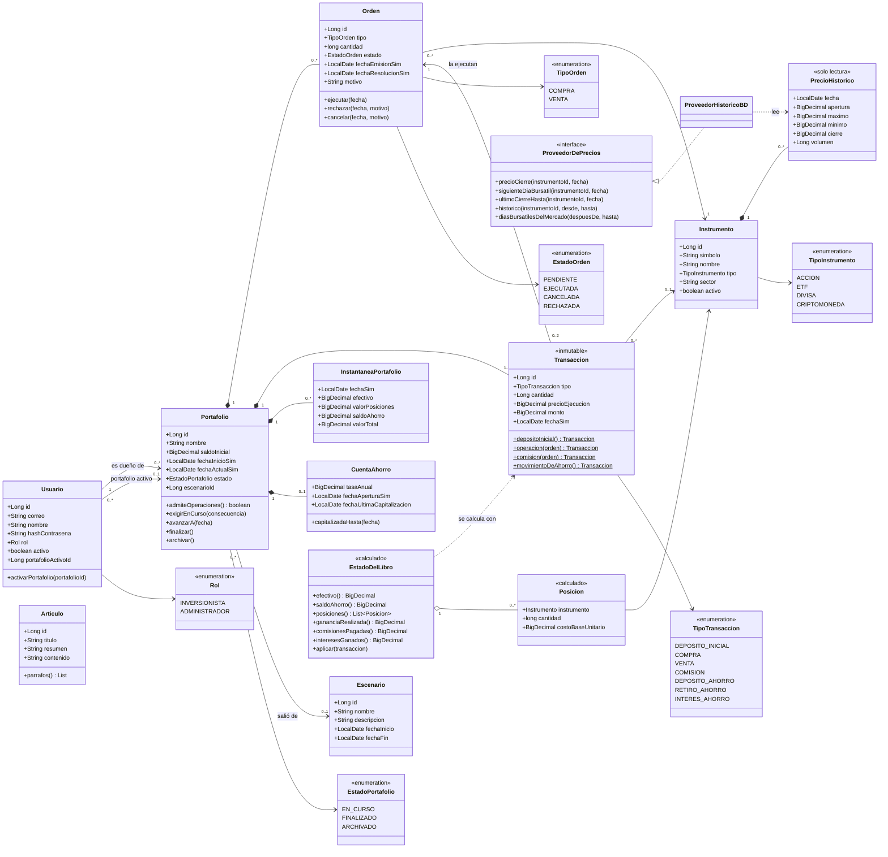
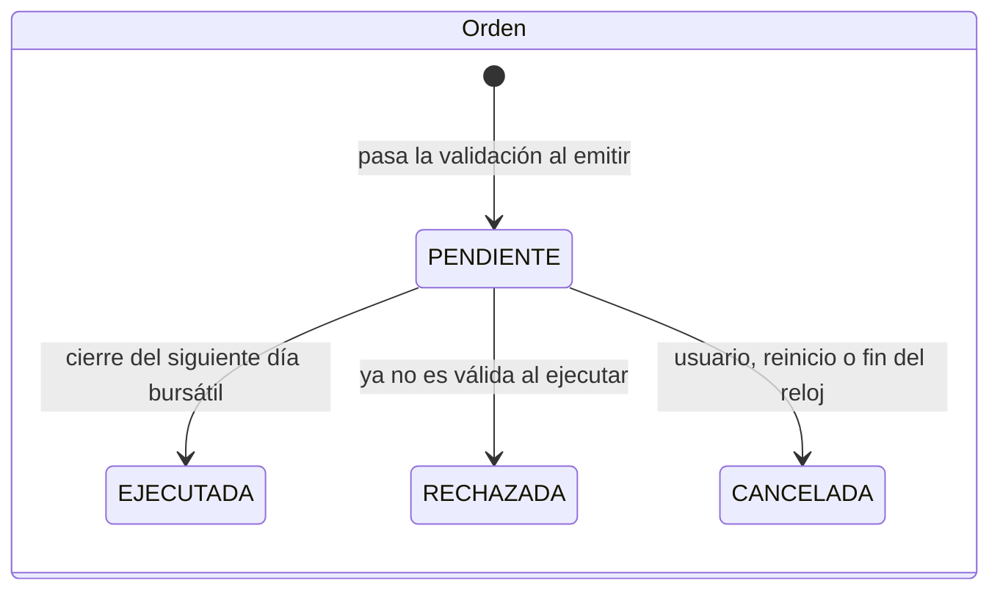
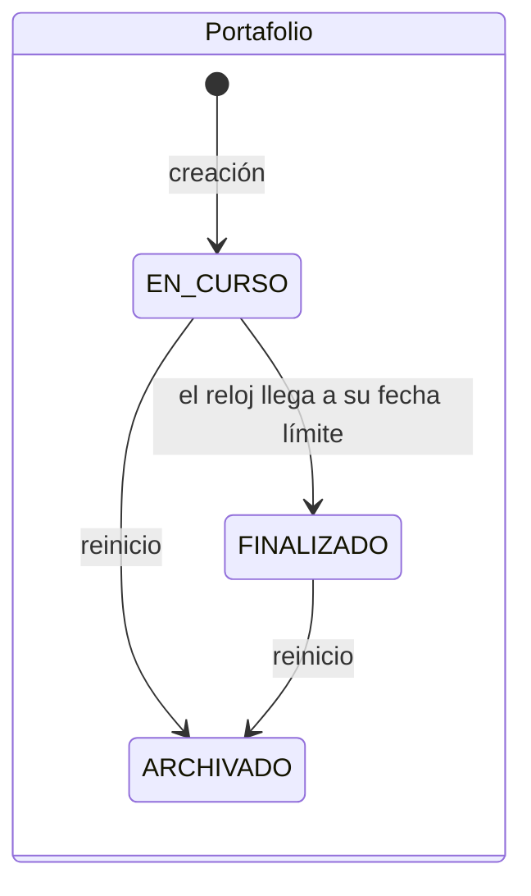

# Cambios pendientes en el SRS y en el diagrama de clases

El SRS (IEEE 830) y el PDF de diagramas UML se entregaron antes de terminar la implementación. Este documento reúne lo que hay que cambiar en ellos para que coincidan con el código y con `requerimientos.md` versión 2.1.

Cada sección trae el texto o el diagrama listo para copiar.

## 1. Alcance

| Sección del SRS | Qué dice hoy | Qué debe decir |
|---|---|---|
| Alcance del producto | Instrumentos: acciones y ETF | Instrumentos: acciones, ETF, divisas y criptomonedas |
| Fuera de alcance | "Instrumentos distintos de acciones y ETFs" | Quitar esa línea. Agregar: "Contabilidad en varias monedas: las divisas solo existen como instrumento que se compra y se vende en USD" |
| Moneda | Moneda ficticia sin nombre | Dólares de Estados Unidos (USD) ficticios para el efectivo y para todos los precios |

**Justificación para el documento.** Los precios históricos reales de los instrumentos están en USD. Usar esa misma moneda para el efectivo evita convertir monedas, que seguiría fuera de alcance. Las divisas y las criptomonedas se agregaron como tipos de instrumento porque usan exactamente las mismas órdenes, comisiones y reglas que una acción: no requirieron lógica nueva.

## 2. Reglas de negocio

| Regla | Valor en el SRS | Valor implementado |
|---|---|---|
| RN-01 | Saldo inicial de 10.000.000, entre 1.000.000 y 100.000.000 | US$ 10.000, entre US$ 1.000 y US$ 100.000 |
| RN-04 | Comisión del 0,3 % con mínimo de 5.000 | Comisión del 0,3 % con mínimo de US$ 5 |
| RN-05 | No dice si la comisión entra en el costo base | El costo base no incluye comisiones |
| RN-08 | Una fecha sin precio no es día bursátil | Igual, pero el calendario es por instrumento: una criptomoneda cotiza los fines de semana y una acción no |
| RN-10 | Todo valor se redondea a dos decimales | El dinero se redondea a dos decimales. Los precios se guardan con ocho, porque 1 peso colombiano vale unos 0,00025 USD |

Los montos de RN-01 y RN-04 son los originales divididos entre 1.000, para que guarden proporción con precios reales en USD.

## 3. Políticas que el SRS dejaba abiertas

| Política | Valor |
|---|---|
| Fecha inicial del reloj | La elige el usuario; por defecto, 2 de enero de 2020. Si no es día bursátil, se usa el siguiente |
| Cuenta de ahorro | Tasa nominal anual fija del 4 %. Interés = saldo × tasa × días ÷ 365, sumado en cada día que avanza el reloj |
| Fin de un escenario | El portafolio queda finalizado al llegar a la fecha de fin del escenario |
| Formato del archivo de carga | Un CSV por instrumento: fecha, apertura, máximo, mínimo, cierre y volumen opcional |
| Contraseñas | Entre 8 caracteres y 72 bytes. Sigue siendo provisional |

## 4. Modelo de datos

Diferencias entre el modelo del SRS y las tablas reales:

| Tabla | En el SRS | Implementado |
|---|---|---|
| `CUENTA_AHORRO` | Columnas `saldo` y `tasa_ea` | Sin columna de saldo: se calcula a partir de las transacciones. La tasa es `tasa_anual` (nominal). Agrega `fecha_ultima_capitalizacion` |
| `ESCENARIO` | `duracion_dias` | `fecha_fin` |
| `ARTICULO` | Sin resumen | Agrega `resumen` |
| `INSTRUMENTO` | `tipo` con ACCION y ETF | `tipo` con ACCION, ETF, DIVISA y CRIPTOMONEDA |
| `PRECIO_HISTORICO` | Precios con cuatro decimales; volumen obligatorio | Precios `DECIMAL(20,8)`; el volumen admite nulo (las divisas no tienen) |
| `TRANSACCION` | Tipos: depósito inicial, compra, venta, comisión | Agrega DEPOSITO_AHORRO, RETIRO_AHORRO e INTERES_AHORRO. `precio_ejecucion` es `DECIMAL(20,8)` |
| `PORTAFOLIO` | Sin escenario | Agrega `escenario_id` (opcional) y `version` para el bloqueo optimista |
| `USUARIO` | Sin portafolio activo | Agrega `portafolio_activo_id` (opcional) |
| `INSTANTANEA_PORTAFOLIO` | Efectivo, posiciones y total | Agrega `saldo_ahorro` |

Modelo completo:

```
USUARIO (id, correo UNIQUE, nombre, hash_contrasena, rol, activo, fecha_registro, portafolio_activo_id?)
PORTAFOLIO (id, usuario_id, nombre, saldo_inicial, fecha_inicio_sim, fecha_actual_sim, estado, escenario_id?, creado_en, version)
ORDEN (id, portafolio_id, instrumento_id, tipo, cantidad, estado, fecha_emision_sim, fecha_resolucion_sim?, motivo?, creado_en, version)
TRANSACCION (id, portafolio_id, tipo, orden_id?, instrumento_id?, cantidad?, precio_ejecucion?, monto, fecha_sim, creado_en)
INSTRUMENTO (id, simbolo UNIQUE, nombre, tipo, sector?, activo)
PRECIO_HISTORICO (instrumento_id, fecha, apertura, maximo, minimo, cierre, volumen?)   -- clave: instrumento_id + fecha
INSTANTANEA_PORTAFOLIO (portafolio_id, fecha_sim, efectivo, valor_posiciones, saldo_ahorro, valor_total)   -- clave: portafolio_id + fecha_sim
CUENTA_AHORRO (portafolio_id, tasa_anual, fecha_apertura_sim, fecha_ultima_capitalizacion)   -- clave: portafolio_id
ESCENARIO (id, nombre, descripcion, fecha_inicio, fecha_fin, orden_visualizacion)
ARTICULO (id, titulo, resumen, contenido, orden_visualizacion)
```

El dinero usa `DECIMAL(18,4)` y los precios `DECIMAL(20,8)`. El monto de una transacción siempre es positivo; el signo lo da el tipo.

## 5. Diagrama de clases

### Correcciones al diagrama entregado

| En el diagrama entregado | Corrección |
|---|---|
| `Portafolio.eliminar()` | Quitarlo. Un portafolio nunca se borra |
| Reinicio como "borrar transacciones y restaurar saldo" | El reinicio archiva el portafolio y crea uno nuevo con las mismas condiciones |
| `avanzarReloj(dias)` | `avanzar(fechaDeDestino)`: recibe una fecha, no una cantidad de días |
| Estados del portafolio | En curso, Finalizado y Archivado |
| Una orden sin efectivo pasa a RECHAZADA al emitirla | Una orden que no pasa la validación no se crea. RECHAZADA solo ocurre al ejecutar |
| La comisión es un atributo de la transacción | La comisión es una transacción aparte, de tipo COMISION |
| `Posicion` como clase persistente | `Posicion` no se guarda: se calcula a partir de las transacciones |
| `CuentaAhorro.saldo` | Quitarlo. El saldo se calcula a partir de las transacciones |
| `TipoInstrumento` con ACCION y ETF | Agregar DIVISA y CRIPTOMONEDA |

### Diagrama actualizado

GitHub dibuja este bloque como diagrama. También se puede pegar en <https://mermaid.live> para exportarlo como imagen.



Notas para leer el diagrama:

- Una orden ejecutada produce dos transacciones: la operación (COMPRA o VENTA) y su COMISION.
- `EstadoDelLibro` y `Posicion` no son tablas. Se calculan recorriendo las transacciones del portafolio en orden.
- Todo portafolio tiene al menos una transacción: su depósito inicial.

## 6. Diagramas de estados





## 7. Requerimientos que cambiaron frente al SRS

Los flujos vigentes están en `requerimientos.md` versión 2.1. Estos son los que difieren de lo entregado:

| Requerimiento | Cambio |
|---|---|
| REQ-003 | El usuario elige también la fecha en que empieza el reloj |
| REQ-004 | Filtra por cuatro tipos de instrumento. Funciona sin portafolio activo, con precios hasta la fecha real |
| REQ-005 | El rango del gráfico se elige entre cinco opciones fijas (1 mes, 6 meses, 1 año, 5 años, todo), no con fechas libres |
| REQ-006 y REQ-007 | La validación descuenta las órdenes pendientes: dos órdenes válidas por separado no pueden superar juntas el efectivo o la posición |
| REQ-009 | El reloj se detiene en la fecha límite: el fin del escenario o el último dato del histórico |
| REQ-014 | El escenario tiene fecha de fin; al llegar a ella el portafolio queda finalizado |
| REQ-017 | Un instrumento deshabilitado no admite compras, pero se puede vender lo que ya se tiene |
| REQ-018 | Un archivo por instrumento. Las fechas que ya existen se omiten sin sobrescribirlas |
